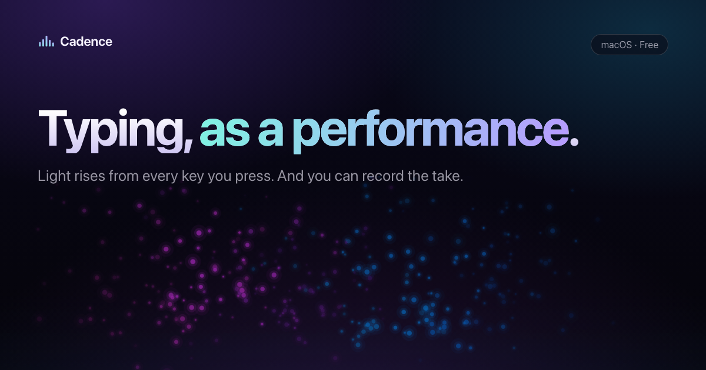
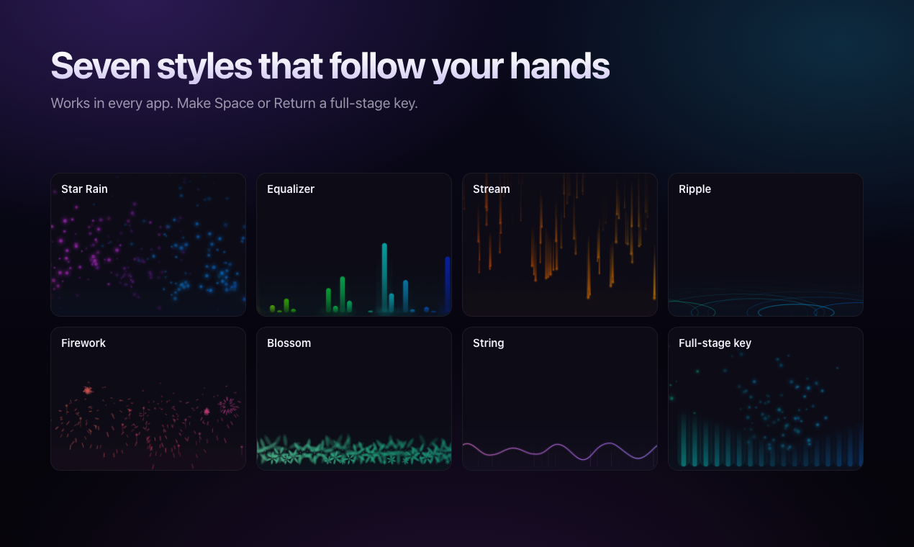

  <b>Light rises from every key you press. And you can record the take.</b> 
  <a href="https://cadenceapp.mimos.top">Website</a> ·
  <a href="https://github.com/mimose/cadence-releases/releases/latest/download/Cadence.dmg">Download</a> ·
  <a href="#中文">中文</a>

## Download

**[Cadence.dmg](https://github.com/mimose/cadence-releases/releases/latest/download/Cadence.dmg)** — free, 8 MB, Apple silicon & Intel, macOS 13+.

Cadence isn't notarized yet. On first launch, macOS will say it can't verify the developer:
**System Settings → Privacy & Security → Open Anyway**. You only need to do this once.

## What it does

- A quiet strip at the bottom of your screen lights up wherever you press, in any app
- 7 styles: Star Rain, Equalizer, Stream, Ripple, Firework, Blossom, String
- Full-stage keys: make Space or Return set off a wave, sweep or flash
- Record a take: rhythm, peak combo and hand balance; replay it or export a vertical poster

## Privacy

Cadence needs **Input Monitoring**, but reads key codes only — never characters — and goes silent in password fields.
Takes stay on your Mac. Only update checks go online, and you can turn them off. Crash reports are opt-in.

## Updates

The app updates itself. Every release is listed under [Releases](https://github.com/mimose/cadence-releases/releases).

---

## 中文

每次按键，屏幕底部对应的位置都会升起一束光；还能把这一段录下来。

**下载：[Cadence.dmg](https://github.com/mimose/cadence-releases/releases/latest/download/Cadence.dmg)**（免费，8 MB，Apple 芯片与 Intel，macOS 13+）

首次打开提示「无法验证开发者」：**系统设置 → 隐私与安全性 → 仍要打开**，只需一次。

- 七种风格：星雨、均衡器、流光、波纹、烟花、花瓣、琴弦
- 全场键：空格、回车可以触发冲击波、横扫、闪光
- 录一段：节奏、峰值连击、左右手；可回放，可导出竖屏海报，画面里没有文字
- 只读键码，读不到你打的字；密码框里自动静默；片段只存在本机；只有检查更新会联网（可关）；崩溃报告需同意才发送

---

This repository hosts release builds and the Sparkle feed (`releases/latest/download/appcast.xml`). Source code is private.
